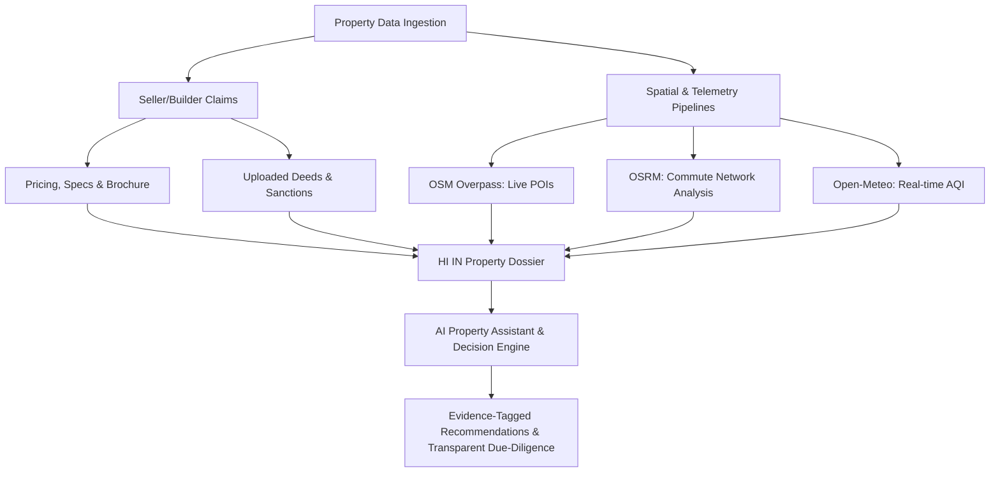
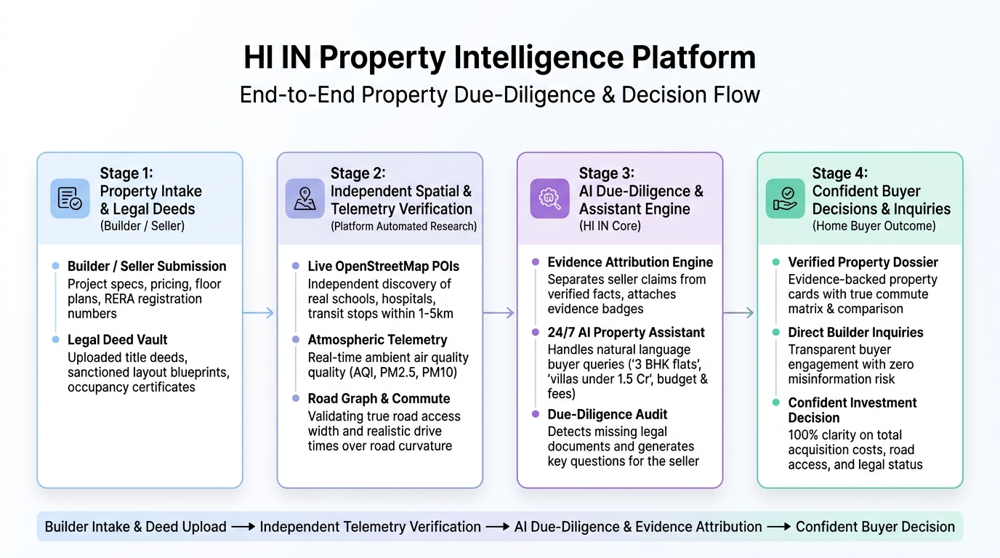
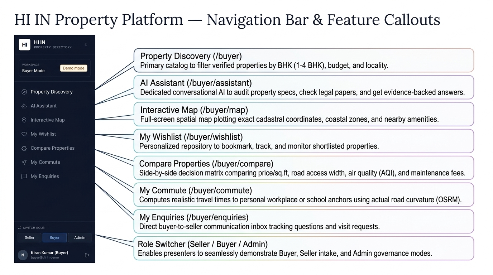
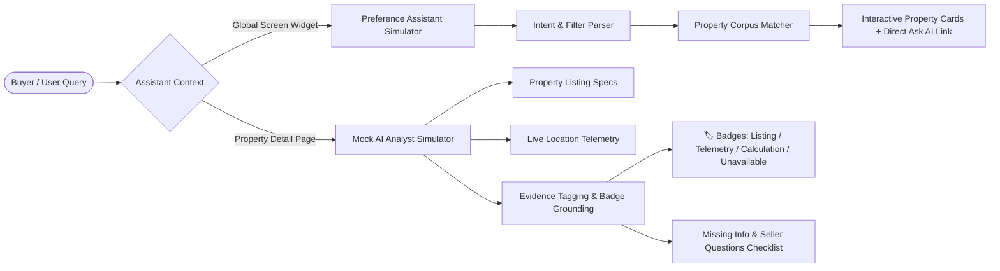

# HI IN Property Intelligence Platform
## Complete Client Presentation, Feature Guide & System Architecture Documentation

---

## 1. Executive Summary & Value Proposition

### 1.1 The Industry Problem
Traditional real estate listing portals suffer from a structural incentive misalignment:
* **Unverified Claims**: Portals treat developer marketing claims ("5 mins to airport", "luxury green surroundings") as uncontested facts.
* **Hidden Trade-offs**: Crucial information regarding road width, actual peak-hour commute times, air quality degradation, and unaccounted overhead charges (corpus funds, clubhouse fees, stamp duty) are buried in fine print.
* **Lack of Spatial Due-Diligence**: Buyers are forced to juggle multiple external apps (Google Maps, air quality monitors, municipal portals) to verify whether a property fits their lifestyle.

### 1.2 The HI IN Solution
**HI IN Property Intelligence Platform** is an **evidence-backed real estate directory and decision engine**. It enforces an architectural distinction between:
1. **Seller-Provided Claims**: What the builder or homeowner states (price, carpet area, listed amenities, possession timeline).
2. **Platform-Verified Spatial Context**: Live, independent telemetry calculated directly from spatial graph networks (OpenStreetMap Overpass, OSRM road curvature commute graph, Open-Meteo atmospheric telemetry).
3. **AI Due-Diligence Synthesis**: Structured analysis that cites every data source, flags missing legal documents, computes real-world acquisition costs, and answers buyer questions without hallucination.



---

## 2. End-to-End Property Due-Diligence & Decision Flow




### 2.1 Technology Stack

| Layer | Technologies Used | Key Responsibilities & Capabilities |
| :--- | :--- | :--- |
| **Frontend Framework** | **React 19, TypeScript, Vite** | Fast modern SPA, compile-time type safety, zero runtime crashes. |
| **Styling & UI** | **Tailwind CSS, Lucide Icons** | High-contrast, clean visual hierarchy; dark slate navigation (`#0f172a`), crisp white content canvas. |
| **State Management** | **TanStack Query (React Query v5)** | Optimistic UI updates, caching, automatic server-state synchronization. |
| **Spatial Mapping** | **Leaflet.js + OpenStreetMap** | Interactive vector tile maps, coordinate pinning, radius discovery rings. |
| **Backend API** | **Python 3.13, FastAPI** | High-performance asynchronous REST API, auto-generating Swagger/OpenAPI docs. |
| **Data Layer** | **SQLAlchemy 2.0, SQLite / PostgreSQL** | Relational data persistence with strict foreign key constraints and PostGIS-compatible coordinates. |
| **Authentication** | **JWT Bearer Tokens, Bcrypt** | Secure stateless sessions with role-based route guards (`buyer`, `seller`, `admin`). |
| **Telemetry Engines** | **OSM Overpass, Open-Meteo, OSRM** | Live nearby amenities, atmospheric air quality telemetry, driving/cycling road routing. |
| **AI Decision Engine** | **Dual AI Assistant Engine** | Global natural-language preference matcher + contextual property due-diligence evaluator. |

---

## 3. End-to-End User Roles & Feature Workflows

The application is architected around **three distinct persona workflows**, plus a ubiquitous **AI Assistant suite**.

---

### Persona 1: The Buyer (`buyer@hi-in.demo`)
*Goal: Discover properties with complete spatial awareness, verify developer claims against live telemetry, calculate true commute times, and ask questions through AI.*



#### 1. Interactive Directory & Intelligent Filtering (`/buyer`)

* **Live Keyword & Budget Search**: Instant filter by property type (Apartment, Villa, Plot), city locality (Madhurawada, Rushikonda, MVP Colony), price range, and construction status.
* **Card Metadata with Provenance Badges**: Each card displays price per sq.ft., possession date, and clear `"Seller provided / Unverified"` safety tags.
* **Direct "Ask AI" Shortcut**: Instant transition from any listing card directly into the contextual AI assistant with pre-loaded property context.

#### 2. Full-Screen Interactive Spatial Map (`/buyer/map`)
* **Leaflet Map Integration**: Centered over Visakhapatnam coastal corridor with custom markers.
* **Dynamic Coordinate Binding**: Clicking any map pin brings up a slide-over preview showing the asking price, carpet area, and road access width.
* **Locality Clustering**: Allows buyers to visualize project density relative to coastal zones, IT SEZ corridors, and national highways.

#### 3. Property Intelligence Dossier (`/buyer/properties/:id`)
A comprehensive, tabbed single-property report divided into verified modules:
* **Core Specifications**: Floor count, total units, road frontage width, survey number, and payment milestone terms.
* **Nearby Amenities Explorer (OSM Overpass)**: Real-time query of actual schools, hospitals, transit stops, and grocery stores within 1 km, 3 km, and 5 km, showing real walking and driving distances.
* **Atmospheric Quality Card (Open-Meteo)**: Live PM2.5, PM10, European AQI index, and health recommendations tailored to families and active individuals.
* **Road Connectivity & Access**: Evaluates road access width (e.g., 18m or 24m) and road network connectivity to prevent buyers from investing in landlocked or narrow-access projects.
* **Verified Document Vault**: Preview and download RERA Registration Certificates, GVMC/VMRDA Sanctioned Plans, and Fire NOCs.
* **Direct Inquiry Form**: Instant messaging directly to the verified listing seller.

#### 4. Personalized Commute Matrix (`/buyer/commute`)
* **Custom Anchor Points**: Buyers set their daily workplace (e.g., *IT SEZ Hill 2*), children’s school, or airport.
* **OSRM Road Network Calculations**: Instead of misleading straight-line distance, the engine computes actual driving and transit times over actual road geometry.
* **Multi-Property Commute Comparison**: Side-by-side commute duration comparison across all shortlisted properties.

#### 5. Multi-Property Comparison Matrix (`/buyer/compare`)
* Select up to 4 properties side-by-side.
* Compares price, price/sqft, road width, maintenance cost, amenities, AQI, and distance to key hubs.
* Highlights differences in green and amber to help buyers spot superior value instantly.

---

### Persona 2: The Seller / Builder (`seller@hi-in.demo`)
*Goal: List properties with structured integrity, upload compliance documents, pass automated consistency checks, and manage buyer inquiries.*

#### 1. Seller Command Center (`/seller`)
* High-level executive counters: Total Active Listings, Inquiries Received, Total Property Views, and Compliance Health.
* Quick actions to publish new inventory or update existing listings.

#### 2. Multi-Step Intake & Compliance Engine (`/seller/new-listing`)
* **Step 1: Identity & Geocoded Location**: Property title, typology, district, and address. Built-in geocoder resolves coordinates accurately.
* **Step 2: Physical & Spatial Specifications**: Carpet area, total units, towers, floors, survey number, road access width (m), and frontage (m).
* **Step 3: Pricing & Commercial Terms**: Base price, payment schemes (e.g., 20:80 construction-linked), corpus fund, parking fee, and monthly maintenance.
* **Step 4: Deed & Document Vault**: Upload RERA certificates, sanctioned layout blueprints, occupancy certificates, and high-resolution elevations.
* **Automated Consistency Validation**: Flags discrepancies (e.g., missing survey numbers or unrealistic road access) before listing publication.

#### 3. Inquiries Inbox (`/seller/enquiries`)
* View inquiries submitted by prospective buyers.
* Displays buyer name, contact details, intended timeline, and referenced property with status tracking (*New*, *Contacted*, *Closed*).

#### 4. Listing Analytics (`/seller/analytics`)
* Views over time, engagement metrics, and buyer interest breakdowns per property.

---

### Persona 3: The Platform Admin (`admin@hi-in.demo`)
*Goal: Enforce platform integrity, monitor automated research jobs, audit telemetry APIs, and ensure zero fraudulent listings.*

#### 1. Platform Governance Overview (`/admin`)
* Real-time platform pulse: Total registered properties, verified ratio, active background research jobs, open data quality issues.

#### 2. Listing Moderation Queue (`/admin/listings`)
* Review submitted properties before public publication.
* One-click **Approve**, **Reject**, or **Flag for Legal Review**.

#### 3. Automated Spatial Research Jobs (`/admin/jobs`)
* Background pipeline execution logs.
* Tracks spatial indexing, OSM amenity radius calculation, and air quality telemetry polling for each property.

#### 4. Telemetry Data Source Health (`/admin/sources`)
* Live health status and latency monitoring for external spatial APIs:
  * OpenStreetMap Nominatim Geocoding (Latency: ~118ms)
  * Open-Meteo Atmospheric Grid (Latency: ~95ms)
  * OSRM Road Graph Engine (Latency: ~142ms)
  * CPCB Ambient Air Sensor Grid (Latency: ~210ms)

#### 5. Data Quality Issues & Flagging (`/admin/issues`)
* Automated and human-submitted quality flags (e.g., *"Environmental clearance pending upload"* or *"Survey number boundary discrepancy"*).
* Ticket resolution workflow with severity tiers (*High*, *Medium*, *Low*).

#### 6. Immutable Audit Trail (`/admin/audit-log`)
* Cryptographically traceable log of administrative actions: listing approvals, user credential changes, system initializations.

---

## 4. The AI Property Assistant Suite (Client Showcase Highlight)

The AI Assistant is built to demonstrate how modern buyers interact with real estate intelligence through natural language while maintaining 100% factual accuracy.



### 4.1 Ubiquitous Floating Assistant Widget (Bottom-Right)
* **Always Available**: Docked at `bottom-6 right-6` across every screen in the application.
* **Natural Language Preference Parsing**:
  * *"I'm searching for 3bhk flats"* $\rightarrow$ Filters and presents 3 BHK options (e.g., Ramez Seapoint, Urbanrise The Coast) with pricing, locality, and direct links.
  * *"2bhk"* $\rightarrow$ Recommends verified 2 BHK coastal apartments.
  * *"Villas under 1.5 Cr"* $\rightarrow$ Parses budget and property typology constraints.
  * *"What additional costs should I expect?"* $\rightarrow$ Outlines stamp duty (6-7.5%), registration charges, corpus funds, and GST.
* **Interactive Recommendation Cards**: In-chat property cards allowing buyers to click **"View Listing & Ask AI"** to seamlessly navigate into that property's detailed dossier.

### 4.2 Contextual Property Due-Diligence Assistant
Located directly inside the property detail view as a dedicated tab and header button:
* **Grounded in Property Facts**: Understands the specific property's carpet area, floor count, asking price, builder profile, and road width.
* **Clear Evidence Attribution**: Every assertion carries an explicit source badge:
  * `[Property listing]` — Sourced directly from seller's uploaded specs.
  * `[Seller-provided information]` — Information claimed by developer, pending municipal verification.
  * `[Location research]` — Sourced from OSM spatial graph or Open-Meteo telemetry.
  * `[Sample calculation]` — Mathematical estimates for registration and maintenance.
  * `[Information unavailable]` — Transparently flags what the listing does *not* state instead of guessing.
* **Missing Information Checklist**: Automatically detects if critical documents (e.g., Occupancy Certificate, Environmental Clearance) are missing and generates suggested questions for the buyer to ask the seller.

---

## 5. Live Client Presentation Script (20-Minute Walkthrough)

Follow this structured script when presenting the platform to clients and management:

### Phase 1: The Pitch & Executive Vision (Minutes 0 - 3)
1. Open the landing page at [http://localhost:5173](http://localhost:5173).
2. **Key Talking Point**:
   > *"Most real estate platforms act as advertising billboards for developers, repeating unsubstantiated claims. HI IN is built on a different principle: **Evidence-Backed Intelligence**. We give buyers independent spatial context, real-time telemetry, and AI due-diligence so they make confident, fully verified investments."*

---

### Phase 2: The Buyer Experience & Location Telemetry (Minutes 3 - 10)
1. Click **"Explore Directory"** or log in as Buyer (`buyer@hi-in.demo` / `demopass123`).
2. Show the **Directory Page**:
   * Point out the filters (Locality, Budget, Type).
   * Note the `"Seller provided / Unverified"` disclaimer tags on every card.
3. Open a property, e.g., **"Ramez Seapoint"**:
   * Scroll to the **Nearby Amenities Explorer**: Highlight how schools, hospitals, and transit are calculated using real OpenStreetMap spatial nodes, not static estimates.
   * Highlight the **Air Quality Card**: Real-time atmospheric telemetry (PM2.5, AQI) pulled for Madhurawada.
   * Highlight the **Road Connectivity Card**: Verification of the 18-meter road access width.
4. Open the **"My Commute"** tool (`/buyer/commute`):
   * Show how setting an anchor point (e.g., *IT SEZ Hill 2*) instantly computes real driving route times via OSRM for all properties.
5. Open the **"Compare Properties"** tool (`/buyer/compare`):
   * Compare *Ramez Seapoint* vs. *Sreeja Ocean View* side-by-side to show direct metric comparison.

---

### Phase 3: The AI Assistant Experience (Minutes 10 - 15)
1. **Global Widget Demo**:
   * Click the floating **"Ask AI Assistant"** widget in the bottom-right corner.
   * Type: `"i'm searching for 3bhk flats"`
   * Show the response: The assistant parses the bedroom count, finds matching properties, and displays interactive cards with prices and direct links.
   * Type: `"what extra costs will I have to pay?"`
   * Show the response: Detailed breakdown of stamp duty, registration, and corpus funds with the `[Sample calculation]` evidence tag.
2. **Contextual Property Assistant Demo**:
   * Click **"View Listing & Ask AI"** on *Ramez Seapoint*.
   * In the property detail view, click the **"AI Property Assistant"** tab.
   * Click the suggested chip: *"What are the key advantages and potential drawbacks?"*
   * Point out the **Evidence Badges** attached to each sentence:
     > *"Notice that the AI never makes a claim without citing its source. When discussing the ocean view, it tags `[Property listing]`. When discussing coastal road connectivity, it tags `[Location research]`. When a document is missing, it explicitly tags `[Information unavailable]`."*
   * Click the chip: *"What questions should I ask the seller?"* to show buyer empowerment.

---

### Phase 4: Seller Intake & Admin Oversight (Minutes 15 - 18)
1. Switch to Seller (`seller@hi-in.demo`):
   * Open `/seller/new-listing`. Show the multi-step intake form with automated geocoding and document upload.
   * Explain how uploaded documents are archived in the legal vault.
2. Switch to Admin (`admin@hi-in.demo`):
   * Open `/admin`. Show the Governance Dashboard.
   * Open `/admin/sources` to show the live telemetry monitoring (Open-Meteo, OSM, OSRM).
   * Open `/admin/audit-log` to demonstrate enterprise audit compliance.

---

### Phase 5: Conclusion & Q&A (Minutes 18 - 20)
* Summarize the platform:
  * **Zero Hallucination Risk**: Strict grounding and badge taxonomy.
  * **Production Ready**: Full RBAC, automated testing (18/18 passing tests), responsive design.
  * **Extensible**: Seamless transition path from SQLite to PostgreSQL/PostGIS and local mock models to live Qwen LLM instances.

---

## 6. Pre-Configured Demo Accounts & Credentials

| Role | Username / Email | Password | Primary Demo URL |
| :--- | :--- | :--- | :--- |
| **Buyer** | `buyer@hi-in.demo` | `demopass123` | [http://localhost:5173/buyer](http://localhost:5173/buyer) |
| **Seller / Builder** | `seller@hi-in.demo` | `demopass123` | [http://localhost:5173/seller](http://localhost:5173/seller) |
| **Platform Admin** | `admin@hi-in.demo` | `demopass123` | [http://localhost:5173/admin](http://localhost:5173/admin) |

---

## 7. Automated Test Suite Verification

The application features comprehensive automated end-to-end tests covering all key functionalities:
* **`app.test.tsx`**: Verifies role-based authentication, persona routing, login guards, and state persistence.
* **`assistant.test.tsx`**: Verifies 12 critical AI scenarios:
  * Property specifications extraction
  * Listed amenities verification
  * Additional acquisition costs calculation
  * Missing information checklist generation
  * Seller due-diligence questions generator
  * Graceful fallback for out-of-scope inquiries
  * Global 3 BHK and 2 BHK natural-language intent parsing
  * Villa and budget preference matching

Run tests anytime with:
```bash
npm --prefix frontend test
```
**Status: 18 passed across 2 test files.**
